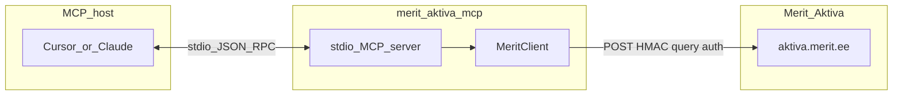

# merit-aktiva-mcp

Open-source [Model Context Protocol](https://modelcontextprotocol.io/) (MCP) server for
**Merit Aktiva**, the Estonian accounting software, via the
[Merit Aktiva API](https://www.merit.ee/) (also serves
[360 Księgowość](https://360ksiegowosc.pl/) in Poland via `MERIT_BASE_URL`).

It exposes customers, vendors, invoices, payments, ledger, reports, offers, recurring
invoices, inventory, fixed assets, and prices as **`merit_`-prefixed MCP tools**, so AI
assistants (Claude, ChatGPT, Cursor, etc.) can work with your Merit Aktiva company.

## Hosted: werkzeug.ee

No install needed. Sign up at [werkzeug.ee](https://werkzeug.ee), get your personal MCP
endpoint (`https://werkzeug.ee/mcp/c/<id>`) and paste it into Claude, ChatGPT or Cursor as
a remote MCP server. Client-by-client steps: [werkzeug.ee/docs](https://werkzeug.ee/docs/).

Prefer to run it yourself over **stdio**? See [Prerequisites](#prerequisites) and
[Quick start](#quick-start) below.

## Tools at a glance

<!-- tools:start (generated by npm run docs:readme) -->
**77 tools.** Click a group to expand it.

<details><summary><b>Customers</b> (5)</summary>

| Tool | Description |
|------|-------------|
| `merit_list_customers` | List/search Merit Aktiva customers (POST /api/v1/getcustomers). |
| `merit_create_customer` | Create a Merit Aktiva customer (POST /api/v2/sendcustomer). |
| `merit_update_customer` | Update a Merit Aktiva customer (POST /api/v1/updatecustomer). id is required; other fields are optional patches. |
| `merit_list_customer_groups` | List Merit Aktiva customer groups (POST /api/v2/getcustomergroups). |
| `merit_create_customer_group` | Create a Merit Aktiva customer group (POST /api/v2/sendcustomergroup). id (GUID), name (max 64), and code (max 20) are required. |

</details>

<details><summary><b>Vendors</b> (5)</summary>

| Tool | Description |
|------|-------------|
| `merit_list_vendors` | List/search Merit Aktiva vendors (POST /api/v1/getvendors). |
| `merit_create_vendor` | Create a Merit Aktiva vendor (POST /api/v2/sendvendor). |
| `merit_update_vendor` | Update a Merit Aktiva vendor (POST /api/v2/updatevendor). id is required; other fields are optional patches. v2 supports Dimensions. |
| `merit_list_vendor_groups` | List Merit Aktiva vendor groups (POST /api/v2/getvendorgroups). |
| `merit_create_vendor_group` | Create a Merit Aktiva vendor group (POST /api/v2/sendvendorgroup). id (GUID), name (max 64), and code (max 20) are required. |

</details>

<details><summary><b>Sales invoices</b> (8)</summary>

| Tool | Description |
|------|-------------|
| `merit_list_sales_invoices` | List Merit Aktiva sales invoices for a period (POST /api/v2/getinvoices). periodStart/periodEnd are ISO YYYY-MM-DD and may be at most 3 months apart (Merit… |
| `merit_list_sales_invoices_by_number_or_customer` | List Merit Aktiva sales invoices filtered by invoice number and/or customer (POST /api/v2/getinvoices2). |
| `merit_get_sales_invoice` | Get one Merit Aktiva sales invoice with rows and payments (POST /api/v2/getinvoice). id is the invoice GUID (SIHId from the list tools). |
| `merit_create_sales_invoice` | Create a Merit Aktiva sales invoice (POST /api/v2/sendinvoice). |
| `merit_email_sales_invoice` | SENDS EMAIL: email a Merit Aktiva sales invoice to the customer (POST /api/v2/sendinvoicebyemail). id is the invoice GUID (SIHId). |
| `merit_send_sales_invoice_einvoice` | SENDS E-INVOICE: send a Merit Aktiva sales invoice as an e-invoice (POST /api/v2/sendinvoiceaseinv). id is the invoice GUID (SIHId). |
| `merit_get_sales_invoice_pdf` | Get a Merit Aktiva sales invoice PDF as base64 (POST /api/v2/getsalesinvpdf). |
| `merit_delete_sales_invoice` | DESTRUCTIVE: delete a Merit Aktiva sales invoice (POST /api/v1/deleteinvoice). id is the invoice GUID (SIHId). |

</details>

<details><summary><b>Sales offers</b> (6)</summary>

| Tool | Description |
|------|-------------|
| `merit_list_sales_offers` | List Merit Aktiva sales offers (POST /api/v2/getoffers). periodStart/periodEnd are ISO YYYY-MM-DD and may be at most 3 months apart. dateType: 0 = document… |
| `merit_get_sales_offer` | Get one Merit Aktiva sales offer with rows (POST /api/v2/getoffer). id is the offer GUID. |
| `merit_create_sales_offer` | Create a Merit Aktiva sales offer (POST /api/v2/sendoffer). offerNo, customer, offerRows, taxAmount[], and totalAmount (ex-VAT) are required. docType: 1 =… |
| `merit_update_sales_offer` | Update a Merit Aktiva sales offer (POST /api/v2/updateoffer). offerNo identifies the offer; deliveryDate, hComment, and fComment are the writable fields. |
| `merit_set_sales_offer_status` | Change a Merit Aktiva sales offer status (POST /api/v2/setofferstatus). newStatus: 1 = unsent, 2 = sent, 3 = confirmed, 4 = rejected, 5 = commented (comment… |
| `merit_create_invoice_from_sales_offer` | Create a sales invoice from a Merit Aktiva sales offer (POST /api/v2/offer2inv). id is the offer GUID. |

</details>

<details><summary><b>Payments</b> (6)</summary>

| Tool | Description |
|------|-------------|
| `merit_list_payments` | List Merit Aktiva payments for a period (POST /api/v2/getpayments). periodStart/periodEnd are ISO YYYY-MM-DD, max 3 months apart. |
| `merit_list_payment_types` | List Merit Aktiva payment types (POST /api/v2/getpaymenttypes). type is required: 1 = purchases, 2 = expense reports, 3 = sales. |
| `merit_create_sales_invoice_payment` | Record a payment against a sales invoice (POST /api/v2/sendpayment). |
| `merit_create_purchase_invoice_payment` | Record a payment for a purchase invoice (POST /api/v2/sendPaymentV). |
| `merit_create_sales_offer_payment` | Record a payment against a sales offer (POST /api/v2/sendPaymentO). |
| `merit_delete_payment` | DESTRUCTIVE: delete a Merit Aktiva payment (POST /api/v1/deletepayment). id is the payment GUID. |

</details>

<details><summary><b>Purchases</b> (5)</summary>

| Tool | Description |
|------|-------------|
| `merit_list_purchase_invoices` | List Merit Aktiva purchase invoices for a period (POST /api/v2/getpurchorders). periodStart/periodEnd are ISO YYYY-MM-DD, max 3 months apart. dateType: 0 =… |
| `merit_get_purchase_invoice` | Get one Merit Aktiva purchase invoice with rows and payments (POST /api/v2/getpurchorder). id is the purchase invoice GUID (PIHId). |
| `merit_list_purchase_orders` | List Merit Aktiva purchase orders waiting approval (POST /api/v2/GetPOrders). |
| `merit_create_purchase_invoice` | Create a booked Merit Aktiva purchase invoice (POST /api/v2/sendpurchinvoice). |
| `merit_delete_purchase_invoice` | DESTRUCTIVE: delete a Merit Aktiva purchase invoice (POST /api/v1/deletepurchinvoice). id is the purchase invoice GUID (PIHId). |

</details>

<details><summary><b>General ledger</b> (4)</summary>

| Tool | Description |
|------|-------------|
| `merit_list_gl_batches` | List Merit Aktiva general-ledger batches (POST /api/v1/getglbatches). periodStart/periodEnd are ISO YYYY-MM-DD, max 3 months apart. dateType: 0 = document… |
| `merit_get_gl_batch` | Get one Merit Aktiva GL batch with entries (POST /api/v1/getglbatch). id is the batch GUID (GLBId). |
| `merit_list_gl_batches_full` | List Merit Aktiva GL batches with entries and cost allocations in one call (POST /api/v1/GetGLBatchesFull). |
| `merit_create_gl_batch` | Create a Merit Aktiva general-ledger batch (POST /api/v1/sendglbatch). entryRows need accountCode plus debit and/or credit. batchDate is ISO YYYY-MM-DD. |

</details>

<details><summary><b>Accounts</b> (1)</summary>

| Tool | Description |
|------|-------------|
| `merit_list_accounts` | List the Merit Aktiva chart of accounts (POST /api/v1/getaccounts). usageFilter: 0 or omitted = all accounts, 1 = cost accounts, 2 = cost contra-accounts, 3 =… |

</details>

<details><summary><b>Taxes</b> (1)</summary>

| Tool | Description |
|------|-------------|
| `merit_list_taxes` | List all Merit Aktiva tax (VAT) rates (POST /api/v1/gettaxes). |

</details>

<details><summary><b>Items</b> (5)</summary>

| Tool | Description |
|------|-------------|
| `merit_list_items` | List/search Merit Aktiva items (POST /api/v1/getitems). id wins over other filters; code and description are broad (partial) matches. usage: 1 = sales, 2 =… |
| `merit_list_item_groups` | List Merit Aktiva item groups (POST /api/v2/getitemgroups). |
| `merit_create_items` | Create Merit Aktiva items (POST /api/v2/senditems). |
| `merit_update_item` | Update a Merit Aktiva item (POST /api/v1/updateitem). id is required; other fields are optional patches. |
| `merit_create_item_groups` | Create Merit Aktiva item groups (POST /api/v2/senditemgroups). |

</details>

<details><summary><b>Reference data</b> (7)</summary>

| Tool | Description |
|------|-------------|
| `merit_list_projects` | List Merit Aktiva projects (POST /api/v1/getprojects). |
| `merit_list_cost_centers` | List Merit Aktiva cost centers (POST /api/v1/getcostcenters). |
| `merit_list_dimensions` | List Merit Aktiva dimensions and their values (POST /api/v2/getdimensions). |
| `merit_list_departments` | List Merit Aktiva departments (POST /api/v1/getdepartments). |
| `merit_list_units` | List Merit Aktiva units of measure (POST /api/v1/getunits). |
| `merit_list_banks` | List Merit Aktiva banks / payment methods (POST /api/v1/getbanks). |
| `merit_list_financial_years` | List Merit Aktiva accounting periods / financial years (POST /api/v2/getaccperiods). |

</details>

<details><summary><b>Reports</b> (7)</summary>

| Tool | Description |
|------|-------------|
| `merit_get_customer_debts_report` | Customer debts report (POST /api/v1/getcustdebtrep). |
| `merit_get_customer_payments_report` | Customer payments report (POST /api/v2/getcustpaymrep). |
| `merit_get_profit_report` | Income statement / P&L (POST /api/v1/getprofitrep). endDate is ISO YYYY-MM-DD; periodCount is the number of months back. |
| `merit_get_balance_report` | Balance sheet / statement of financial position (POST /api/v1/getbalancerep). endDate is ISO YYYY-MM-DD; periodCount is the number of months. |
| `merit_get_inventory_report` | Inventory report (POST /api/v2/getinventoryreport). reportDate is ISO YYYY-MM-DD. |
| `merit_get_sales_report` | Sales report (POST /api/v2/getsalesrep). reportType: 1 = invoices, 2 = customers, 3 = articles, 4 = countries, 5 = countries general. |
| `merit_get_purchase_report` | Purchase report (POST /api/v2/getpurchrep). reportType: 1 = invoices, 2 = vendors, 3 = articles, 4 = fixed assets. |

</details>

<details><summary><b>Recurring invoices</b> (5)</summary>

| Tool | Description |
|------|-------------|
| `merit_list_recurring_invoices` | List Merit Aktiva recurring invoices (POST /api/v2/getperinvoices). |
| `merit_get_recurring_invoice` | Get one Merit Aktiva recurring invoice with rows (POST /api/v2/getperinvoice). id is the recurring-invoice GUID. |
| `merit_create_recurring_invoice` | Create a Merit Aktiva recurring invoice (POST /api/v2/sendperinvoice). cycle: 1 = month, 2 = quarter, 3 = year, 4 = week. period: 2 = current, 3 = next, 4 =… |
| `merit_list_recurring_invoice_addresses` | List client addresses for open Merit Aktiva recurring invoices (POST /api/v2/getpershaddress). |
| `merit_send_recurring_indication_values` | Send meter / indication values for recurring invoices (POST /api/v1/sendindvalues). artCode is the article; each value may set endValue or quantity (quantity… |

</details>

<details><summary><b>Inventory</b> (3)</summary>

| Tool | Description |
|------|-------------|
| `merit_list_locations` | List Merit Aktiva stock locations (POST /api/v2/getlocations). |
| `merit_list_inventory_movements` | List Merit Aktiva inventory movements (POST /api/v2/getinvmovements). periodStart/periodEnd are ISO YYYY-MM-DD, max 3 months apart. dateType: 0 = document… |
| `merit_create_inventory_movement` | Create a Merit Aktiva inventory movement (POST /api/v2/SendInvMovement). type: 1 = in (itemUnitCost required on rows), 2 = out, 3 = between stocks… |

</details>

<details><summary><b>Fixed assets</b> (4)</summary>

| Tool | Description |
|------|-------------|
| `merit_list_fixed_asset_locations` | List Merit Aktiva fixed-asset locations (POST /api/v2/getfalocations). |
| `merit_list_fixed_asset_employees` | List Merit Aktiva fixed-asset responsible employees (POST /api/v2/getfaresppersons). |
| `merit_list_fixed_assets` | List Merit Aktiva fixed assets (POST /api/v2/getfixassets). |
| `merit_create_fixed_assets` | Create Merit Aktiva fixed assets (POST /api/v2/sendfixedassets). |

</details>

<details><summary><b>Prices and discounts</b> (5)</summary>

| Tool | Description |
|------|-------------|
| `merit_list_prices` | List Merit Aktiva sales prices (POST /api/v2/getprices). |
| `merit_get_price` | Get the valid sales price for a customer on a date (POST /api/v2/getprice). itemCode and docDate are required; provide customerId, or custName / custRegNo. |
| `merit_send_prices` | Create or replace Merit Aktiva sales prices (POST /api/v2/sendprices). targetGroup: 0 = campaign, 1 = customer, 2 = customer group. |
| `merit_list_discounts` | List Merit Aktiva sales discounts (POST /api/v2/getdiscounts). |
| `merit_send_discounts` | Create or replace Merit Aktiva sales discounts (POST /api/v2/senddiscounts). targetGroup: 1 = customer, 2 = customer group. groupType: 1 = item, 2 = item group. |

</details>
<!-- tools:end -->

API paths and required arguments per tool: [Tools](#tools).

> **Status:** OSS stdio package is complete for GitLab issues M1–M6 (auth, reads,
> writes, extended domains). Bank import, settlements, expense/income/prepayments,
> and dimension/tax/unit mutations are [deferred](docs/api-coverage.md).

Endpoint → tool mapping and official-vs-seed quirks: [docs/api-coverage.md](docs/api-coverage.md).

## Prerequisites

- **Node.js 20+** (see `package.json` `engines`; native `fetch`; CI uses Node 20 and 22).
- A **Merit Aktiva** company with **Pro/Premium** (API Settings is not on lower plans).
- Merit has **no sandbox**. Use a free test company (Program Settings → API Settings)
  or a real company you control.

### API credentials

Create keys as an admin in **Merit Aktiva → Settings → API Settings**:

1. Add an API client. Merit shows an **Api ID** and **Api Key**.
2. Copy them into `.env` as `MERIT_API_ID` and `MERIT_API_KEY` (never commit `.env`).

Poland (360 Księgowość): set `MERIT_BASE_URL=https://program.360ksiegowosc.pl`.

## Quick start

```bash
git clone https://github.com/werkstatt-jasper/merit-aktiva-mcp.git
cd merit-aktiva-mcp
cp .env.example .env   # set MERIT_API_ID / MERIT_API_KEY
npm install
npm run build
npm start              # MCP server on stdio
```

## Environment

Copy `.env.example` to `.env` and fill in values. The server loads `.env` via
`dotenv` with `quiet: true` so the banner cannot corrupt MCP stdio. **Never commit
`.env`** (it is gitignored).

| Variable | Required | Default | Description |
| --- | --- | --- | --- |
| `MERIT_API_ID` | yes | — | Api ID from Settings → API Settings |
| `MERIT_API_KEY` | yes | — | Api Key (HMAC-SHA256 shared secret; never sent on the wire) |
| `MERIT_BASE_URL` | no | `https://aktiva.merit.ee` | Poland: `https://program.360ksiegowosc.pl` |
| `MERIT_HTTP_MAX_RETRIES` | no | `0` | Extra attempts on 429/5xx/network errors |
| `MERIT_HTTP_RETRY_BASE_MS` | no | `500` | Exponential backoff base delay |
| `MERIT_REQUEST_TIMEOUT_MS` | no | `30000` | Outbound HTTP timeout |
| `LOG_LEVEL` | no | `info` | pino level; logs go to **stderr** only |

Structured logs go to **stderr** only. **stdout** is reserved for MCP JSON-RPC.

## MCP host configuration

Point your MCP client at the built server (`dist/index.js`). Use an **absolute** path.

**Cursor** (`~/.cursor/mcp.json` or project `.cursor/mcp.json`):

```json
{
  "mcpServers": {
    "merit-aktiva": {
      "command": "node",
      "args": ["/absolute/path/to/merit-aktiva-mcp/dist/index.js"],
      "env": {
        "MERIT_API_ID": "your_api_id",
        "MERIT_API_KEY": "your_api_key"
      }
    }
  }
}
```

**Claude Desktop** — same `mcpServers` shape in `claude_desktop_config.json`
(macOS: `~/Library/Application Support/Claude/`; Linux: `~/.config/Claude/`;
Windows: `%APPDATA%\Claude\`).

If `.env` is populated and the working directory is the project root, `npm start`
picks up credentials without duplicating them in the MCP client `env` block.

## Architecture



## Authentication

Merit signs every request with **HMAC-SHA256** query parameters (`apiId`, UTC
`timestamp` as `yyyyMMddHHmmss`, `signature`):

1. Body is `JSON.stringify` of the payload (**compact** — pretty-print will not match
   the official signing vector).
2. Signature is HMAC-SHA256 over `utf8(apiId + timestamp + rawBody)`, then
   URL-encoded on the query string.
3. On **429** / 5xx retries the client **must** mint a fresh timestamp and signature
   (reusing the first signature fails). See `src/auth.ts` and `src/client.ts`.

The Api Key never leaves the process. URLs logged on error have the query string
stripped.

## Dates and periods

- Tool date arguments accept ISO `YYYY-MM-DD` and are converted to Merit's `yyyymmdd`.
- List filters (`periodStart` / `periodEnd`) are capped by Merit at **3 months**,
  except recurring-invoice lists (**max 180 days**; period = next-invoice date).
- Offer and purchase-invoice payments send `PaymentDate` as `yyyyMMddHHmm`
  (ISO date or datetime in, midnight if date-only).
- Paginated reports continue via `HasMore` / `Id4More` → `POST /api/v2/getmoredata`
  (`merit_get_customer_payments_report` does this automatically).

## Destructive and send-external tools

These tools mutate the company or send mail. Descriptions start with **DESTRUCTIVE**
or **SENDS …**:

- `merit_delete_sales_invoice`, `merit_delete_purchase_invoice`, `merit_delete_payment`
- `merit_email_sales_invoice` (**SENDS EMAIL**)
- `merit_send_sales_invoice_einvoice` (**SENDS E-INVOICE**; receiver not capable → `api-noeinv`)

Sales invoices **cannot be updated** — delete and recreate. Credit invoice: negative
quantity and `totalAmount`.

## Tools

Each tool `POST`s to the Merit API. Required columns are MCP argument names (camelCase);
the client maps them to PascalCase wire fields. Full path matrix:
[docs/api-coverage.md](docs/api-coverage.md).

### Customers

| Tool | API | Required |
| --- | --- | --- |
| `merit_list_customers` | `/api/v1/getcustomers` | — |
| `merit_create_customer` | `/api/v2/sendcustomer` | `name`, `notTDCustomer`, `countryCode` |
| `merit_update_customer` | `/api/v1/updatecustomer` | `id` |
| `merit_list_customer_groups` | `/api/v2/getcustomergroups` | — |
| `merit_create_customer_group` | `/api/v2/sendcustomergroup` | `id`, `name`, `code` |

### Vendors

| Tool | API | Required |
| --- | --- | --- |
| `merit_list_vendors` | `/api/v1/getvendors` | — |
| `merit_create_vendor` | `/api/v2/sendvendor` | `name`, `vatAccountable`, `countryCode` |
| `merit_update_vendor` | `/api/v2/updatevendor` | `id` |
| `merit_list_vendor_groups` | `/api/v2/getvendorgroups` | — |
| `merit_create_vendor_group` | `/api/v2/sendvendorgroup` | `id`, `name`, `code` |

### Sales invoices

| Tool | API | Required |
| --- | --- | --- |
| `merit_list_sales_invoices` | `/api/v2/getinvoices` | `periodStart`, `periodEnd` |
| `merit_list_sales_invoices_by_number_or_customer` | `/api/v2/getinvoices2` | — |
| `merit_get_sales_invoice` | `/api/v2/getinvoice` | `id` |
| `merit_create_sales_invoice` | `/api/v2/sendinvoice` | `customer`, `invoiceNo`, `docDate`, `invoiceRows`, `taxAmount`, `totalAmount` |
| `merit_get_sales_invoice_pdf` | `/api/v2/getsalesinvpdf` | `id` |
| `merit_email_sales_invoice` | `/api/v2/sendinvoicebyemail` | `id` |
| `merit_send_sales_invoice_einvoice` | `/api/v2/sendinvoiceaseinv` | `id` |
| `merit_delete_sales_invoice` | `/api/v1/deleteinvoice` | `id` |

### Sales offers

| Tool | API | Required |
| --- | --- | --- |
| `merit_list_sales_offers` | `/api/v2/getoffers` | `periodStart`, `periodEnd` |
| `merit_get_sales_offer` | `/api/v2/getoffer` | `id` |
| `merit_create_sales_offer` | `/api/v2/sendoffer` | `customer`, `offerNo`, `docDate`, `offerRows`, `taxAmount`, `totalAmount` |
| `merit_update_sales_offer` | `/api/v2/updateoffer` | `offerNo` |
| `merit_set_sales_offer_status` | `/api/v2/setofferstatus` | `id`, `newStatus` (`comment` required when `newStatus` is 5) |
| `merit_create_invoice_from_sales_offer` | `/api/v2/offer2inv` | `id` |

DocType: 1 = quote, 2 = order, 3 = prepayment. DocStatus: 1–7 (7 = canceled).

### Payments

| Tool | API | Required |
| --- | --- | --- |
| `merit_list_payments` | `/api/v2/getpayments` | `periodStart`, `periodEnd` |
| `merit_list_payment_types` | `/api/v2/getpaymenttypes` | `type` (1 = purchases, 2 = expense reports, 3 = sales) |
| `merit_create_sales_invoice_payment` | `/api/v2/sendpayment` | `customerName`, `invoiceNo`, `paymentDate`, `amount` |
| `merit_create_purchase_invoice_payment` | `/api/v2/sendPaymentV` | `vendorName`, `billNo`, `paymentDate`, `amount` |
| `merit_create_sales_offer_payment` | `/api/v2/sendPaymentO` | `customerName`, `offerNo`, `paymentDate`, `amount` |
| `merit_delete_payment` | `/api/v1/deletepayment` | `id` |

### Purchases

| Tool | API | Required |
| --- | --- | --- |
| `merit_list_purchase_invoices` | `/api/v2/getpurchorders` | `periodStart`, `periodEnd` |
| `merit_get_purchase_invoice` | `/api/v2/getpurchorder` | `id` |
| `merit_list_purchase_orders` | `/api/v2/GetPOrders` | `periodStart`, `periodEnd` |
| `merit_create_purchase_invoice` | `/api/v2/sendpurchinvoice` | `vendor`, `billNo`, `docDate`, `invoiceRows`, `taxAmount`, `totalAmount` |
| `merit_delete_purchase_invoice` | `/api/v1/deletepurchinvoice` | `id` |

`GetPOrders` is purchase orders waiting for approval, not the booked purchase-invoice list.
`sendpurchinvoice` books immediately (bypasses approval).

### General ledger

| Tool | API | Required |
| --- | --- | --- |
| `merit_list_accounts` | `/api/v1/getaccounts` | — |
| `merit_list_gl_batches` | `/api/v1/getglbatches` | `periodStart`, `periodEnd` |
| `merit_get_gl_batch` | `/api/v1/getglbatch` | `id` |
| `merit_list_gl_batches_full` | `/api/v1/GetGLBatchesFull` | `periodStart`, `periodEnd` |
| `merit_create_gl_batch` | `/api/v1/sendglbatch` | `docNo`, `batchDate`, `entryRows` |

### Items

| Tool | API | Required |
| --- | --- | --- |
| `merit_list_items` | `/api/v1/getitems` | — |
| `merit_list_item_groups` | `/api/v2/getitemgroups` | — |
| `merit_create_items` | `/api/v2/senditems` | `items` |
| `merit_update_item` | `/api/v1/updateitem` | `id` |
| `merit_create_item_groups` | `/api/v2/senditemgroups` | `itemGroups` |

### Reference data

| Tool | API | Required |
| --- | --- | --- |
| `merit_list_taxes` | `/api/v1/gettaxes` | — |
| `merit_list_projects` | `/api/v1/getprojects` | — |
| `merit_list_cost_centers` | `/api/v1/getcostcenters` | — |
| `merit_list_dimensions` | `/api/v2/getdimensions` | — |
| `merit_list_departments` | `/api/v1/getdepartments` | — |
| `merit_list_units` | `/api/v1/getunits` | — |
| `merit_list_banks` | `/api/v1/getbanks` | — |
| `merit_list_financial_years` | `/api/v2/getaccperiods` | — |

### Reports

| Tool | API | Required |
| --- | --- | --- |
| `merit_get_customer_debts_report` | `/api/v1/getcustdebtrep` | — |
| `merit_get_customer_payments_report` | `/api/v2/getcustpaymrep` | `periodStart`, `periodEnd` |
| `merit_get_profit_report` | `/api/v1/getprofitrep` | `endDate`, `periodCount` |
| `merit_get_balance_report` | `/api/v1/getbalancerep` | `endDate`, `periodCount` |
| `merit_get_inventory_report` | `/api/v2/getinventoryreport` | `reportDate` |
| `merit_get_sales_report` | `/api/v2/getsalesrep` | `startDate`, `endDate`, `reportType` |
| `merit_get_purchase_report` | `/api/v2/getpurchrep` | `startDate`, `endDate`, `reportType` |

### Recurring invoices

| Tool | API | Required |
| --- | --- | --- |
| `merit_list_recurring_invoices` | `/api/v2/getperinvoices` | `periodStart`, `periodEnd` |
| `merit_get_recurring_invoice` | `/api/v2/getperinvoice` | `id` |
| `merit_create_recurring_invoice` | `/api/v2/sendperinvoice` | `customer`, `startDate`, `nextDate`, `cycle`, `period`, `invoiceRows`, `taxAmount`, `totalAmount` |
| `merit_list_recurring_invoice_addresses` | `/api/v2/getpershaddress` | — |
| `merit_send_recurring_indication_values` | `/api/v1/sendindvalues` | `artCode`, `values` |

### Inventory

| Tool | API | Required |
| --- | --- | --- |
| `merit_list_locations` | `/api/v2/getlocations` | — |
| `merit_list_inventory_movements` | `/api/v2/getinvmovements` | `periodStart`, `periodEnd` |
| `merit_create_inventory_movement` | `/api/v2/SendInvMovement` | `docDate`, `type`, `rows` |

Type: 1 = in, 2 = out, 3 = between stocks.

### Fixed assets

| Tool | API | Required |
| --- | --- | --- |
| `merit_list_fixed_asset_locations` | `/api/v2/getfalocations` | — |
| `merit_list_fixed_asset_employees` | `/api/v2/getfaresppersons` | — |
| `merit_list_fixed_assets` | `/api/v2/getfixassets` | — |
| `merit_create_fixed_assets` | `/api/v2/sendfixedassets` | `fixedAssets` |

### Prices and discounts

| Tool | API | Required |
| --- | --- | --- |
| `merit_list_prices` | `/api/v2/getprices` | — |
| `merit_get_price` | `/api/v2/getprice` | `itemCode`, `docDate`, plus `customerId` or `custName` / `custRegNo` |
| `merit_send_prices` | `/api/v2/sendprices` | `prices` |
| `merit_list_discounts` | `/api/v2/getdiscounts` | — |
| `merit_send_discounts` | `/api/v2/senddiscounts` | `discounts` |

## Development

```bash
npm run lint            # Biome
npm run test:coverage   # Vitest, 100% coverage thresholds on src/
npm run build           # tsc
npm run test:integration  # live API tests; skip cleanly without credentials
```

See [CONTRIBUTING.md](CONTRIBUTING.md) for the pre-push checklist.

API reference: [Merit AKTIVA Reference Manual](https://api.merit.ee/connecting-robots/reference-manual/)

## Acknowledgements

The endpoint map (paths, request-body fields, and behavioural quirks) was seeded from
[roosa-dev/merit-aktiva-mcp](https://github.com/roosa-dev/merit-aktiva-mcp)
(`src/server.ts` `ENDPOINTS` table), used under the MIT License:

> MIT License — Copyright (c) 2026 Roosa

This project is an independent implementation (typed schemas, retrying signed client,
test suite) and is not affiliated with Merit Software or roosa-dev.

## License

[MIT](LICENSE) — Copyright (c) 2026 Werkstatt OÜ
